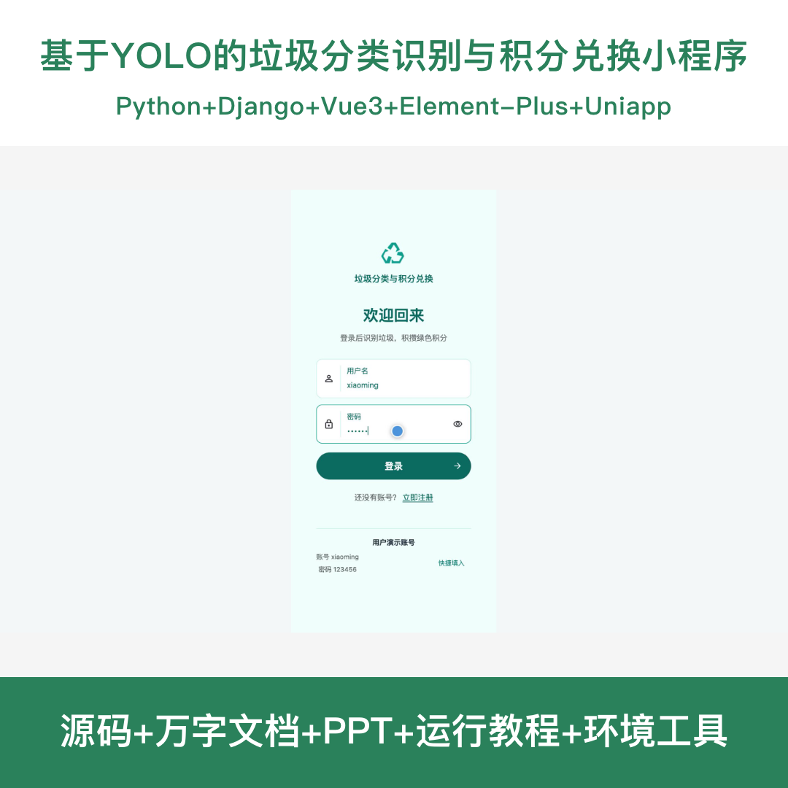
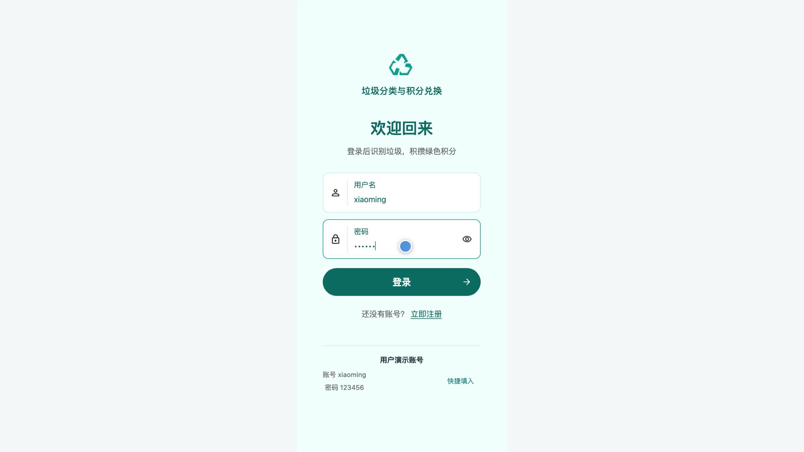
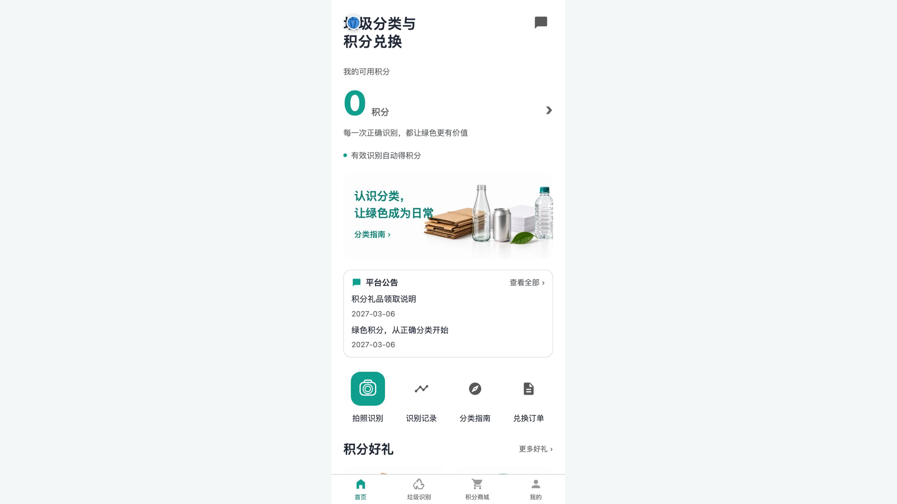
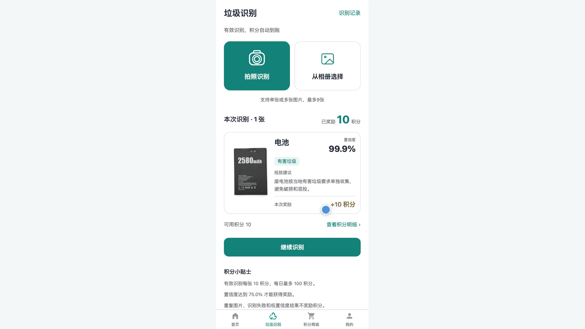
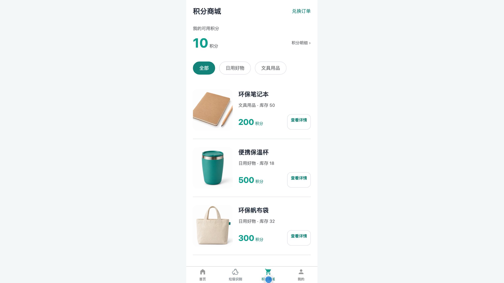
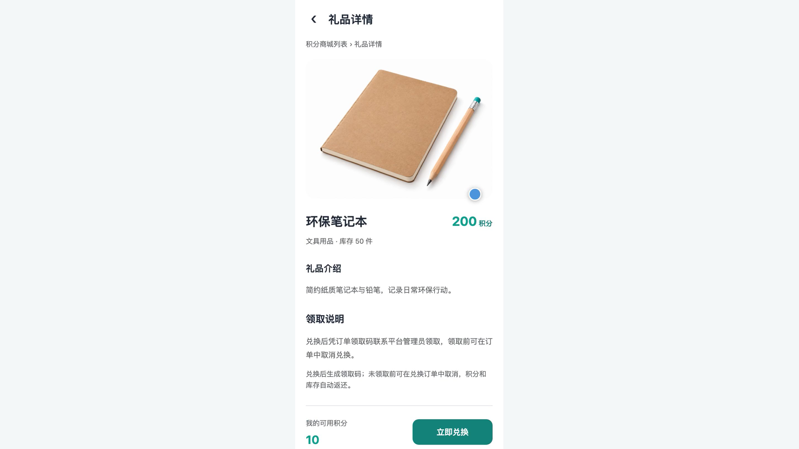
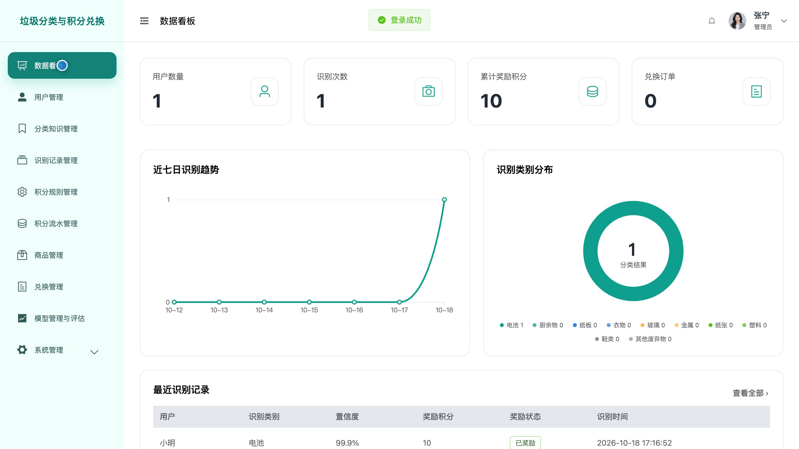
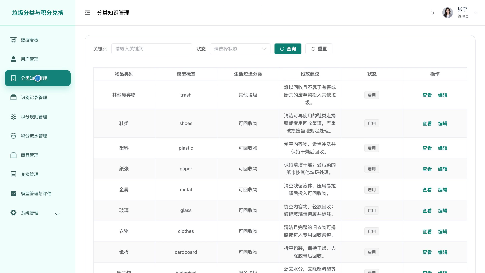
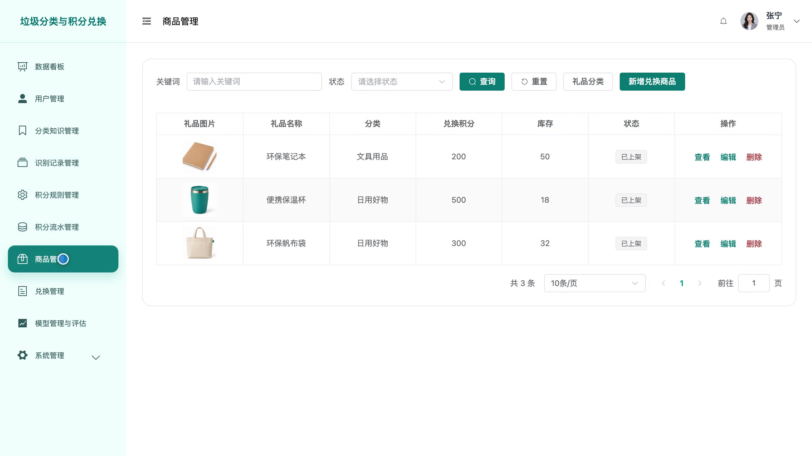

## 源码问题查看主页咨询

### 一、关键词
垃圾分类、智能回收、环保积分、礼品兑换、低碳生活

### 二、作品包含
源码+数据库+全套环境和工具资源+本地部署教程

### 三、项目技术
前端技术： Html、Css、Js、Vue3.4、Element-Plus、uniapp
后端技术：Python、Django、DRF、Ultralytics、OpenCV、YOLO26

### 四、运行环境要求
开发工具：PyCharm + VSCODE + HBuilder X + 微信开发者工具

数据库：MySQL5.7+（共16张表）

数据库管理工具：Navicat10以上版本

环境配置软件： Python3.13

前端Nodejs：20.19.5

浏览器：谷歌浏览器

### 五、项目介绍
项目编号：bs177D

本系统围绕日常垃圾分类与环保激励，提供图片识别、分类投放建议、积分奖励和礼品兑换服务。用户在小程序中拍照或选择相册图片，查看识别结果与积分变化，使用积分兑换礼品并跟踪领取状态；管理员维护分类知识、商品库存与积分规则，核销兑换订单并查看运营数据。

角色：用户、管理员

用户功能：注册登录与个人资料维护、拍照及相册多图垃圾识别与投放建议查看、识别记录与奖励状态查询、积分账户与积分流水查询、积分商城商品浏览与详情查看、积分兑换及订单查询与取消兑换、分类指南检索与详情查看、平台公告与消息阅读。

管理员功能：运营数据看板、礼品分类及商品资料及库存维护、兑换订单查询与领取码核销、用户资料及账号状态管理、垃圾分类知识与识别记录管理、积分规则维护及积分流水查询与异常奖励冲正、模型资料管理及单张批量测试与评估查看、平台公告及基础信息及操作日志及个人资料管理。

### 六、运行截图

